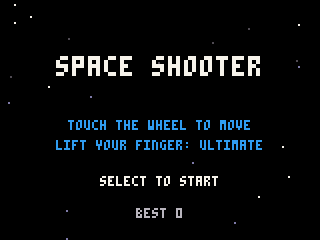
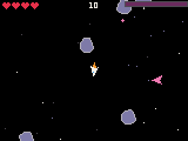
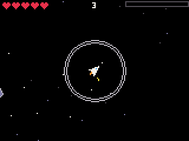
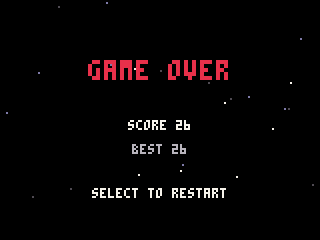

# Space Shooter

Fly a small ship through an endless field of asteroids, stalkers and fighters on your iPod. Your ship aims and fires by itself, so all you do is steer, dodge and pick the moment for your ultimate.

| | |
|---|---|
|  |  |
|  |  |

## Quick start

You need an iPod Video (5th generation) or iPod Classic running [PodBox](https://github.com/anthonyfletcher/podbox).

To install the game:

1. Download `spaceshooter.pbg` from the [latest release](../../releases/latest).
2. Connect your iPod to your computer and copy `spaceshooter.pbg` into its `Games` folder.
3. Eject the iPod, choose **Arcade** on its main menu, and pick **Space Shooter**.
4. Press **Select** to start.

## How to play

The controls:

| Do this | To |
|---|---|
| Touch the click wheel | Fly towards your finger. The ship speeds up over half a second. |
| Lift your finger | Slow to a stop. If the bar in the top-right corner is blinking red, this also fires your **ultimate**. |
| Press **Select** | Start a game, or play again after a game over |
| Hold **Menu** | Open the pause menu: high scores, help, settings, quit |

Your ship shoots by itself at the nearest enemy on the screen.

The enemies you will meet:

- **Asteroids** (grey) drift in a straight line and never turn.
- **Stalkers** (red) chase you, fast.
- **Fighters** (pink) circle you and shoot back.

A few things to know:

- You have five hearts, shown top left. Touching an enemy or being shot costs one.
- When you are hit, enemies close to you are pushed away and their bullets vanish. Your ship blinks for a moment, and while it blinks nothing can hurt it.
- The **ultimate** takes 7 seconds to charge. It sends out a ring that hurts and pushes back everything near you, most of all the enemies closest to you, and wipes out the bullets it touches.
- The space wraps around: fly off one side and you come back on the other.
- The longer you survive, the more enemies there are. Your best score is kept on the iPod.
